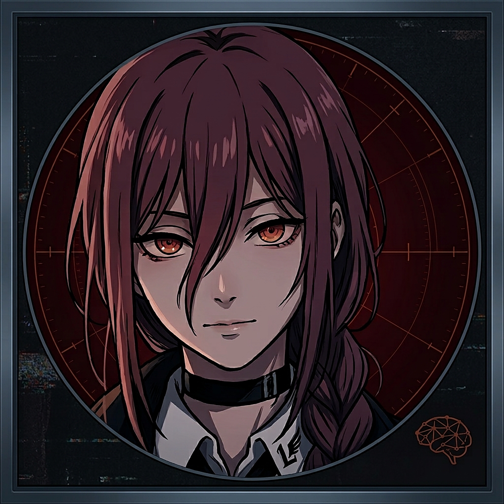

# Liscia Agent



A personal computer-use agent that runs **100% locally** on free models via [Ollama](https://ollama.com).
It works like ChatGPT's agent: screenshot → the model picks one action → it moves the mouse / clicks / types /
opens sites → repeat. It ships with a green-on-black terminal chat app and a **Chrome side panel**.

- Common commands run instantly with no model ("open safari", "search youtube for X and play the first video").
- In Safari/Chrome on macOS it reads the page's links and buttons directly (fast and accurate) and falls back to screenshots.
- Safety: Esc/F12, the STOP button, or slamming the mouse into a screen corner stops it. It asks before typing passwords or
  clicking buy/send/submit/delete. Every step's screenshot is saved to `runs/`.

> Tested on macOS (Apple Silicon). Windows support is in the code but has not been tested on a real PC yet.

## Download the app (no Python needed)
Get the latest build from **Releases**: `Liscia-Agent-<ver>-macos-arm64.dmg` (Apple Silicon Macs) or
`Liscia-Agent-<ver>-windows-x64.zip` (Windows), plus `liscia-agent-chrome-extension-<ver>.zip`.
- **macOS:** open the .dmg and drag **Liscia Agent** onto **Applications**. The app is ad-hoc signed, not notarized, so the
  first time, right-click the app → **Open** → **Open** (or go to System Settings → Privacy & Security → *Open Anyway*).
- **Windows:** unzip it anywhere and run `Liscia Agent\Liscia Agent.exe`. If SmartScreen appears, click *More info → Run anyway*.
- You still need **Ollama** (https://ollama.com/download). On first launch Liscia Agent checks Ollama and offers to download
  any missing models, with progress shown in the chat.
- Your settings, `runs/` and the side-panel token live outside the app, in `~/Library/Application Support/Liscia Agent` (macOS)
  or `%APPDATA%\Liscia Agent` (Windows). Edit `config.yaml` there.
- Build it yourself: `scripts/build_mac_dmg.sh` (macOS) or `scripts/build_windows.ps1` (Windows). Pushing a `v*` tag runs
  `.github/workflows/release.yml`, which builds the Windows zip and attaches it to the release.

## Run from source
### 1. Requirements
- **Python 3.10+**: macOS: `brew install python` or python.org. Windows: https://www.python.org/downloads/ (tick **Add python.exe to PATH**).
- **Ollama**: https://ollama.com/download (macOS app / Windows installer). Leave it running.
- About 10 GB of disk for the models. 16 GB+ RAM recommended.

### 2. Get the code and the models
```bash
git clone https://github.com/rizxe134/liscia-agent.git
cd liscia-agent
ollama pull qwen3-vl:4b-instruct   # vision model (reads screenshots)
ollama pull qwen2.5:7b             # text model (chat, routing, planning, page fast path)
ollama pull qwen2.5vl:7b           # optional fallback vision model
```
Model names live in `config.yaml` (`ollama.model`, `text_model`, `fallback_model`). On a weak machine, try `qwen2.5vl:3b`.

### 3. Install

**macOS**
```bash
python3 -m venv .venv
source .venv/bin/activate
pip install -r requirements.txt
python -m unittest discover -s tests -q   # optional: should print OK
```

**Windows (PowerShell)**
```powershell
python -m venv .venv
.venv\Scripts\activate
pip install -r requirements.txt
python -m unittest discover -s tests -q
```

### 4. Run
- **macOS:** double-click `start.command`, or run `python agent.py`.
- **Windows:** double-click `start.bat`, or run `python agent.py`.
- One task from the console: `python agent.py "search youtube for lofi and play the first video"`.

In the chat app, just type. It decides whether to chat or to use the computer. `/do <task>` forces a computer task and `/chat <msg>` forces chat.
Keep the chat window off to the side, because the agent sees the whole screen.

### Optional: a real Mac app in /Applications (macOS only)
`/Applications/Liscia Agent.app` is Mac-specific. Build it from your clone (after creating the `.venv`):
```bash
scripts/build_mac_app.sh            # or: scripts/build_mac_app.sh ~/Applications
```
The app starts Ollama if needed and logs to `app.log`. If you move the folder, re-run the script. On Windows, use `start.bat`
(right-click → Send to → Desktop to create a shortcut).

## 5. Permissions

**macOS** (System Settings → Privacy & Security). Enable these for the app that launches the agent: **Terminal** if you use
`start.command`, or the **Python** entry macOS prompts for if you use Liscia Agent.app.
- **Screen Recording**: to see the screen (without it, screenshots show only the wallpaper).
- **Accessibility**: to move the mouse, click and type.
- **Input Monitoring**: for the Esc/F12 stop key.
- **Automation**: click **OK** when asked whether it may control Safari/Chrome.

Then quit and reopen the app.

Fast page reading (recommended):
- **Safari:** Settings → Advanced → turn on *Show features for web developers*, then **Develop → Allow JavaScript from Apple Events**.
- **Chrome:** **View → Developer → Allow JavaScript from Apple Events**.

**Windows:** no special permissions. If an app runs as Administrator, run the agent as Administrator too so it can click into it.
(The AppleScript page fast path is macOS-only. On Windows it uses screenshots.)

## 6. Chrome side panel (optional)
Chat with Liscia Agent inside Chrome, with live step narration, a green highlight on what it is about to click, STOP / TAKE OVER
buttons, and confirmation prompts in the panel.
1. Start Liscia Agent (the chat app). It serves a bridge on `http://127.0.0.1:8765` (localhost only). Configure it under `panel:` in `config.yaml`.
2. Chrome → `chrome://extensions` → turn on **Developer mode** → **Load unpacked** → select the `chrome-extension/` folder.
3. Copy your token. It is created on first launch and stays on your machine, so never share or commit it.
   - Packaged app, macOS: `cat ~/Library/Application\ Support/PC\ Agent/token | pbcopy`
   - Packaged app, Windows: `Get-Content "$env:APPDATA\Liscia Agent\token" | Set-Clipboard`
   - From source: `~/.pc-agent/token` (macOS: `cat ~/.pc-agent/token | pbcopy`)
4. Click the Liscia Agent toolbar icon to open the side panel, paste the token, and click **CONNECT**.

**Page control (1.2+):** once the token is saved, the extension's background worker keeps a connection to Liscia
Agent even with the panel closed. When Chrome is the browser in use, the agent reads the page through the extension
(the buttons, links and fields, plus dialogs and page text) and acts by element id: click, type, press, select,
scroll, hover, navigate, tabs, wait, read text, screenshot. That's faster and more accurate than screenshots, which
remain the fallback. Check it with `curl -H "X-PCA-Token: $(cat ~/Library/Application\ Support/Liscia\ Agent/token)"
http://127.0.0.1:8765/status`, which shows `"connected": true`. The panel header shows `page control ON`.
The extension asks for the *debugger* permission, which it uses only as a fallback for clicks that a page ignores.
While it's in use, Chrome shows a "started debugging this browser" bar.

Each computer has its own token. Requests without it, or from normal web pages, are rejected.

## Config and files
- `config.yaml`: models, step limits (`max_steps: 40`), safety words, preferred browser, panel port.
- `runs/<timestamp>/`: per-step screenshots and `log.jsonl` (git-ignored).
- `tools/bench.py`, `tools/bench_text.py`: model speed benchmarks.

## Tips
Short, specific tasks work best. A local model takes roughly 2-10 s per step, so speed depends on your GPU/RAM.
